  

# Plant Meristem Climate Resilience

**Author:** Riddhika D · riddhika.d9b@gmail.com

## Question
When rice is flooded, the flood-tolerance gene **SUB1A** makes plants "wait quietly" underwater instead of trying to grow out of the water. Flood-tolerant *Sub1* rice varieties are now grown widely in India.

**Does SUB1A also switch off the cell-division programme in the shoot during submergence?**

SUB1A's effects on elongation, hormones and anaerobic metabolism are well studied. The original microarray study of these rice lines (Jung et al., *Plant Physiology* 2010) did not analyse cell-cycle or meristem genes.

## Data
NCBI GEO **GSE18930**: Affymetrix rice arrays of aerial tissue from the near-identical lines **M202** (flood-intolerant) and **M202(Sub1)** (tolerant), with and without submergence. Data generation is by the original authors; this repository is an independent re-analysis.

## Method (decided before seeing results)
| | |
|---|---|
| Main test | Submergence response of **cell-division genes** (cyclins, CDKs, histone H4, MCM, PCNA) in Sub1 vs M202 |
| Known-biology check | **Cell-expansion genes** (expansins, XTHs) should be held down more in Sub1 |
| Label check | **Anaerobic genes** (ADH, PDC) must rise under submergence in both lines |
| Statistic | Δ = (submerged − control in Sub1) − (submerged − control in M202), log2 |
| Null | 10,000 random gene sets matched for expression level |

Notebook: `rice_sub1_cell_division.ipynb` (Google Colab, about 3–5 minutes). Executed run with outputs: `rice_sub1_cell_division_RUN.ipynb`.

## Answer in one line
**No.** After 1 day underwater, SUB1A does **not** switch off cell-division genes. It holds back **cell-expansion** genes instead, so the "wait underwater" strategy acts on cell growth, not cell division, at this early stage.

## Results (GSE18930, 2 replicates per group, day 0 vs day 1 of submergence)
| Check / test | M202 response | Sub1 response | Sub1 − M202 | p (vs 10,000 matched random sets) |
|---|---|---|---|---|
| **Label check:** anaerobic genes (n = 42) | +1.09 | +1.36 | +0.27 | rise in both lines ✅ PASS |
| **Known-biology check:** cell-expansion genes (n = 43) | −0.24 | −0.43 | **−0.19** | **0.003** ✅ confirms SUB1A restrains growth |
| **Main test:** cell-division genes (n = 45) | −0.02 | +0.07 | +0.09 | 0.83 (one-sided), 0.33 (two-sided) |
| Cell-cycle GO set (n = 168) | +0.04 | +0.10 | +0.06 | 0.77 |

Values are mean log2 changes under submergence. Only 33% of cell-division genes were lower in Sub1 than in M202 (genome-wide: 45%).

**Pre-registered verdict: NULL.** SUB1A had no specific effect on cell-division genes, while the expansion-gene check behaved as expected, showing the analysis could detect a real SUB1A effect.

**Interpretation:** at day 1, SUB1A's quiescence acts through cell expansion (consistent with its known restriction of elongation and gibberellin responses), not by pausing the cell-division programme. A later time point could differ.

## Limits
- Only 2 biological replicates per group, and only one submergence time point (day 1); later stages were not tested.
- Gene sets are defined by gene names, not by experiments.
- Expression only; cell division itself was not measured.
- Whole aerial tissue, not dissected shoot meristems; dividing cells are a small fraction of this tissue, which could hide a meristem-specific effect.
- An independent RNA-seq dataset (GEO GSE102494, same rice lines, 3 replicates, 3 days of submergence) could test a later stage.

## Earlier version (v1): concept demo, not research
The first version of this repository (`Plant_Meristem_Climate_Resillience.ipynb`, `stress_gene_ingest.py`, `environmental_resilience_model.py`) computed a "Lodging Risk Index" and a "Meristemic Resilience Score" from **five hand-entered example rows**. Disclosures:
- All values were illustrative numbers, not measured data.
- The weights (0.55 heat, 0.45 waterlogging) were arbitrary placeholders.
- The two inputs were on different scales (a 0–100 index vs days), so waterlogging barely affected the score.
- No genomic data were used, and the scores do not predict real lodging risk.

The v1 files are kept for transparency only. The earlier "Research Grant Proposal" text has been withdrawn.

## License
MIT
